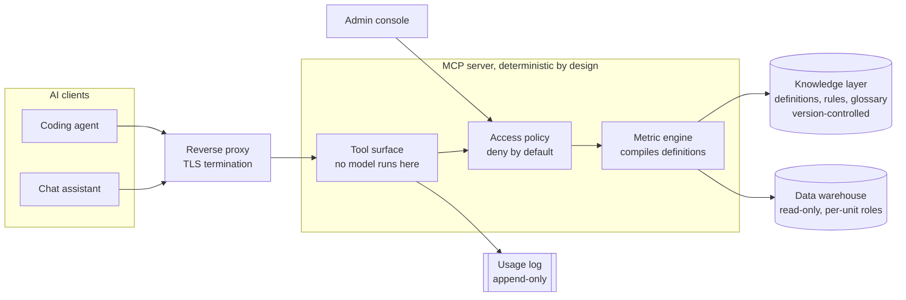

# Governed Metrics MCP

One canonical, governed answer for every business metric, served to AI assistants over the Model Context Protocol.

This repository explains the problem the system solves, how it is built and the decisions that shaped it, and includes a working reference implementation of that design. The production server and the metric definitions it serves stay private. The code here implements the same architecture for an invented two-unit business, and contains none of the production definitions, data, identities or configuration. See [What stays private](#what-stays-private).

---

## The problem

Ask four people for the same number and you get four numbers. Each wrote their own query, each made a defensible choice about which records to include and which date boundary to use, and none of the choices are visible in the result. The meeting that follows argues about whose number is right instead of what to do about it.

Hand-written queries also drift. When an upstream label is renamed or a category is split, a query that filtered on the old value keeps running and keeps returning a smaller number. Nothing fails. The number is simply wrong, and it stays wrong until somebody notices it does not match a different report.

Business rules have the same problem in slower motion. A rule changes, the change is announced once, and people go on quoting the value they remember. Months later two teams are both confident and both out of date.

Giving an AI assistant direct access to the warehouse makes all of this worse rather than better. An assistant with broad credentials can read personal data it was never meant to see, read another business unit's data because nothing stopped it, or run an unbounded scan that takes the warehouse down. Prompt text arriving from a document or a ticket can steer it, so the question it runs is not always the question a person asked.

Two failures make the rest harder to catch. A stale upstream feed usually returns an empty result rather than an error, and an empty result formats as zero, which looks like a real answer. And when a number does reach a leadership deck, nobody can say afterwards which definition produced it.

## The approach

Metric definitions are version-controlled data rather than code. A definition names its measures, dimensions, filters and date anchoring, and the server compiles it into a parameterised read-only query at request time. Changing a definition is a reviewed change with a history, and every answer carries a stamp saying which version of the knowledge produced it.

No language model runs inside the server. The same call against the same definitions returns the same number every time. Composite behaviour ships as fixed tools rather than as a model deciding what to do, which keeps the server auditable and leaves open-ended analysis on the client side where it belongs.

Access is denied by default. A per-user policy governs which units, metrics and dimensions a caller can reach, whether they may query ad hoc at all, and which sources they may read. The application enforces this, and least-privilege database roles enforce it again underneath.

## Architecture at a glance



How a question travels from an assistant to the warehouse, and what stands in its way at each step.

The server listens only on localhost; the proxy in front of it terminates TLS and carries single sign-on. Clients connect over streamable HTTP. Every request passes the access policy before the engine sees it, and every decision lands in the usage log whether it succeeded or was refused.

## Decisions that shaped it

The full set is in [docs/decisions/](docs/decisions/). These are the eight that most changed the result.

**No language model inside the server.** A model in the request path would make the same question return different numbers on different days, which is the exact failure the system exists to remove. Determinism is the product. ([ADR 0001](docs/decisions/0001-deterministic-server.md))

**Definitions as version-controlled data, not code.** A definition that is data can be validated, diffed, reviewed and stamped into provenance. A definition expressed as code can do anything, and its behaviour cannot be summarised to a reader. ([ADR 0002](docs/decisions/0002-definitions-as-data.md))

**Canonical and ad-hoc answers are different products.** Both are useful; conflating them is what lets an exploratory number end up in a board pack. Ad-hoc answers are labelled non-canonical in the response itself, not merely in documentation. ([ADR 0003](docs/decisions/0003-canonical-versus-ad-hoc.md))

**The ad-hoc guard tokenises rather than pattern-matches.** Chained regular expressions were bypassable. A comment, a nested sub-select or unusual whitespace changes how a statement is spelled without changing what it does, so the guard reads it the way the warehouse reads it: a real single-pass lexer. ([ADR 0004](docs/decisions/0004-lexer-not-regular-expressions.md))

**Anything the parser cannot classify is refused.** A guard that guesses when it is unsure is not a guard. Fail-closed produced some false refusals of legitimate queries, which were fixed by teaching the parser the shape it had not seen, never by loosening the default. ([ADR 0005](docs/decisions/0005-fail-closed-parsing.md))

**Per-unit database roles are the real control.** The application guards are a second wall, not the first. If the credential the server holds cannot read a source, no bug in the query path can read it either. ([ADR 0006](docs/decisions/0006-least-privilege-roles.md))

**One business rule is written once and referenced everywhere.** Copies drift. Two definitions that embedded the same rule separately disagreed within months, and neither owner knew. Shared named fragments removed the class of problem rather than the instance. ([ADR 0008](docs/decisions/0008-shared-fragments.md))

**A stale feed must raise an alarm, never return zero.** An empty result is indistinguishable from a true zero once it is formatted, so freshness is checked and a stale answer is refused rather than rendered. ([ADR 0010](docs/decisions/0010-freshness-over-silent-zeros.md))

## Try it

The reference implementation needs Python 3.10 or later. The test suite runs against a fake warehouse, so it needs no database.

```bash
python -m venv .venv && .venv/bin/pip install -e '.[dev]'
.venv/bin/pytest                                  # unit, definition and guard-regression tests
.venv/bin/python scripts/validate_knowledge.py    # the knowledge and policy validators
```

To ask it real questions, start the synthetic warehouse. Each unit gets its own read-only role, so the cross-unit boundary is enforced by PostgreSQL, not only by the server:

```bash
cp examples/warehouse/.env.example examples/warehouse/.env      # choose your own passwords
docker compose -f examples/warehouse/docker-compose.yml --env-file examples/warehouse/.env up -d
cp .env.example .env                                            # put the unit passwords in the DSNs
```

Then register the server with an MCP client over stdio. Locally, the caller is `GM_LOCAL_USER` and the example policy still applies to it:

```json
{
  "mcpServers": {
    "governed-metrics": {
      "command": "/path/to/governed-metrics-mcp/.venv/bin/governed-metrics",
      "env": {
        "GM_KNOWLEDGE_PATH": "/path/to/governed-metrics-mcp/examples/knowledge",
        "GM_POLICY_PATH": "/path/to/governed-metrics-mcp/examples/access.yaml",
        "GM_LOCAL_USER": "lead@example.com",
        "GM_DSN_UNIT_A": "postgresql://gm_unit_a_ro:<password>@127.0.0.1:55432/governed_demo",
        "GM_DSN_UNIT_B": "postgresql://gm_unit_b_ro:<password>@127.0.0.1:55432/governed_demo"
      }
    }
  }
}
```

Things worth asking: revenue for last month in each unit (`get_composite_metric`, where the units name the measure differently and an alias reconciles them); the refund rate for a recent month (still maturing); the marketplace refund rate (refused, because its feed stopped ten days ago); and an ad-hoc query that tries to read the other unit or rename `customer_email`. Switch `GM_LOCAL_USER` to `analyst@example.com` or `partner@example.com` to watch the same questions narrow or get refused.

Over HTTP the server runs as an OAuth resource server behind a TLS-terminating proxy, and it refuses to start without token verification. [docs/reference.md](docs/reference.md) maps every component in these documents to its module and lists the tools, the error vocabulary and the definition format.

## What is in this repository

```
README.md                     the story on one screen
docs/
  architecture.md             context, container and component views, trust boundaries
  request-lifecycle.md        sequence diagrams for five representative requests
  knowledge-model.md          the concepts behind the definition model
  security.md                 threat model, controls, residual risks
  access-model.md             policy concepts, grant and reconcile flow
  operations.md               deploy pipeline, rollback rules, incident playbook
  quality.md                  testing strategy, validators, review practice
  lessons-learned.md          what broke, why, and the guard that prevents it
  roadmap.md                  what is next and what was deliberately deferred
  glossary.md                 terms used throughout
  reference.md                the reference implementation: component map, tools, formats
  decisions/                  numbered decision records
src/governed_metrics/         the MCP server
  adhoc/                      lexer, reference parser, personal-data guard
  engine/                     compiler, executor, freshness, cache
  knowledge/                  definition model, loader, validators
tests/                        unit, definition, guard-regression and integration tests
examples/
  knowledge/                  a synthetic, validated knowledge layer
  access.yaml                 an example deny-by-default policy
  warehouse/                  a local PostgreSQL with per-unit read-only roles
scripts/                      validators, docs generator, overlay reconciliation, deploy pipeline
deploy/                       systemd unit and reverse-proxy example
LICENSE                       Creative Commons Attribution 4.0 (documentation)
LICENSE-CODE                  MIT (code)
```

## What stays private

The production server is built for one organisation, and its metric definitions encode that organisation's rules. Publishing the definitions would publish the business. What transfers between organisations is the architecture, the reasoning and the mechanisms that enforce them, so those are what is here: the guard, the policy and overlay, the masking chokepoint, freshness, maturity and provenance, and the delivery pipeline. The example knowledge they run against is invented.

The engineering problems were general even where the data was not: a guard that disagreed with the parser underneath it, a filter shape that quietly disabled parallel execution, a fail-closed fix that broke valid queries, a deploy that crash-looped on a runtime version mismatch. Those are written up in [lessons-learned.md](docs/lessons-learned.md) in the form most useful to someone building a similar system. The reference implementation guards each one with a regression test or, for the runtime mismatch, a pipeline check.

## License

Documentation is licensed under [Creative Commons Attribution 4.0](LICENSE). Code is licensed under the [MIT License](LICENSE-CODE).
