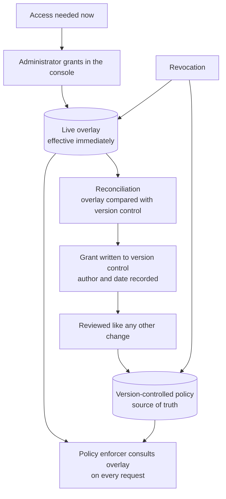

# Access model

Access is denied by default. Nothing is readable because it exists; it is readable because a policy says this caller may read it.

---

## What a policy covers

A policy is resolved from the verified identity at the edge and governs five things:

| Dimension of access | What it decides |
|---|---|
| Units | Which business units the caller may read at all |
| Metrics | Which metrics within those units |
| Dimensions | Which breakdowns, so a sensitive split is not available merely because the metric is |
| Ad-hoc querying | Whether the caller may use the guarded ad-hoc tool, which is a privilege and not a default |
| Sources | Which specific sources the caller may reference in an ad-hoc statement |

Two rules make this tractable in practice.

**Admin rights are separate from data access.** An administrator can manage grants without being able to read the data those grants concern. The two are different jobs and conflating them means anyone who can fix access can also quietly take it.

**A missing entry is a refusal, not a default.** When a policy says nothing about a unit, the answer is no. This is the behaviour that survives somebody forgetting to add a rule, which is the realistic failure mode.

## Granting, revoking and reconciling

Access changes are needed faster than a deploy cycle allows. Somebody joins a team on a Monday and needs a number that morning. The system therefore keeps a live overlay that administrators can change immediately, and reconciles those changes back into version control so the overlay never becomes the real source of truth.

A grant takes effect immediately and is then reconciled into version control, so speed does not cost the audit trail.

The reconciliation step is what keeps this honest. Without it, the overlay accumulates grants nobody remembers making, and the version-controlled policy becomes a document describing a system that no longer exists. With it, the overlay is a short-lived buffer and every grant ends up with an author, a date and a review.

Revocation applies to both places at once. A revocation that removed the overlay entry but left the version-controlled grant would be reinstated at the next deploy, which is the kind of failure that is discovered late and badly.

## Why ad-hoc access is a privilege

The guarded ad-hoc tool returns answers explicitly labelled non-canonical. It exists because exploration is legitimate and people will otherwise do it somewhere with no guards at all.

It is still the highest-risk surface in the system, because it is the one place a caller supplies a statement rather than selecting from declarations. So it is off unless granted, its source allow-list is per-caller rather than per-unit, and its answers carry a label that follows them into whatever document they land in.

## What the log records

Every decision is appended: the caller, the tool, the unit, the knowledge version, the outcome, and for a refusal the reason. Denials are recorded as deliberately as successes.

The log does not record query text and does not record personal data. A log of what people asked, stored next to the system that answered, would be a second copy of the sensitive material with none of the controls. What the log is for is answering two questions: who could see this number, and is somebody repeatedly being refused. Both are answerable from decisions alone.
