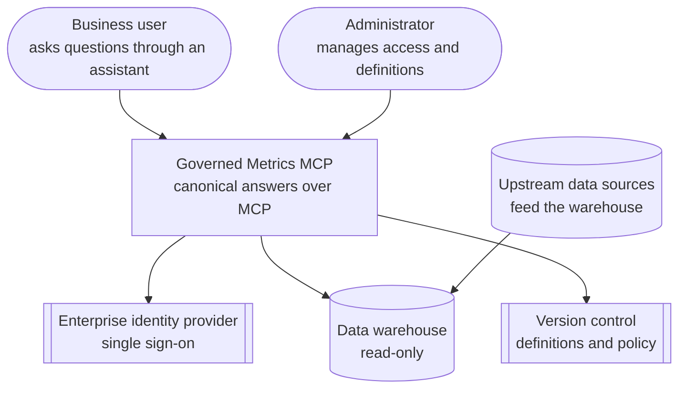
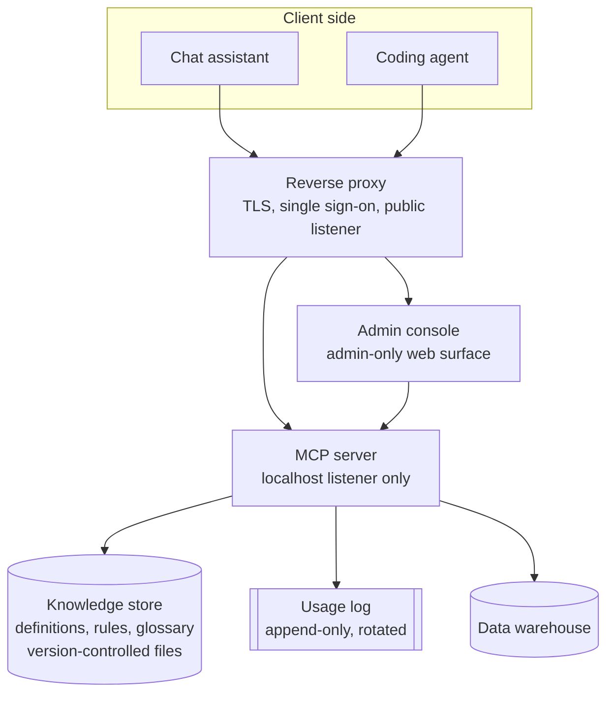
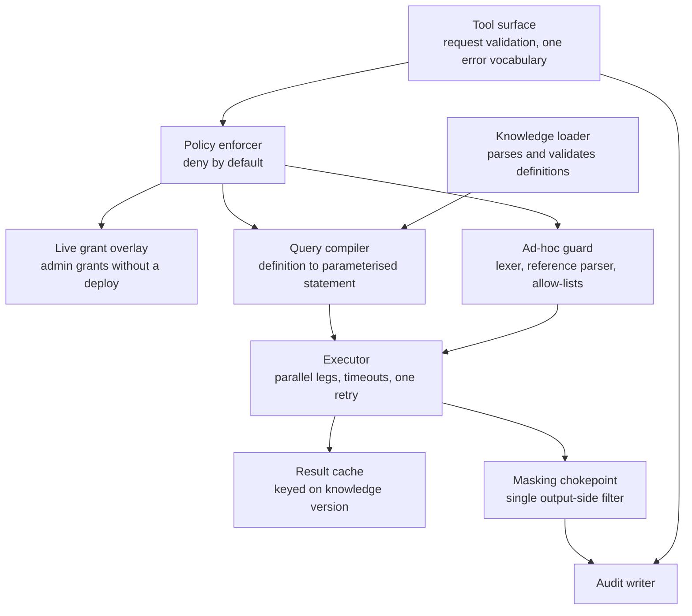
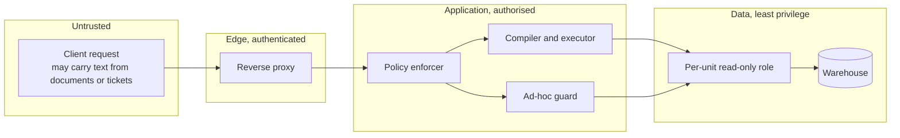

# Architecture

The system answers metric questions from AI clients. It is a governed read path into a data warehouse: definitions decide what a metric means, a policy decides who may ask, and an engine compiles the definition into a parameterised read-only query. No language model runs inside the server.

Components are named by responsibility. None is named after a business domain, because the same architecture serves every unit.

---

## Context

Who uses the system and which external systems it depends on.

The system owns none of the data. It owns the definitions, the policy and the record of what was asked.

## Containers

The deployable pieces and what talks to what; the server is never reachable except through the proxy.

| Container | Responsibility |
|---|---|
| Reverse proxy | Terminates TLS, carries single sign-on, forwards to the server. The only public listener. |
| MCP server | Serves the tool surface over streamable HTTP. Enforces policy, compiles and runs queries, writes the log. Binds to localhost. |
| Admin console | Adoption and performance views, access management. Separate authorisation from data access. |
| Knowledge store | Declarative definitions, layered rules, glossary, reference data. Plain version-controlled files, not a database. |
| Usage log | Append-only record of every decision, including refusals. Owner-only file permissions. |
| Data warehouse | Holds the data. Reached with per-unit, read-only credentials. |

## Components inside the server

The request path inside the server, with the guard and the masking chokepoint on the ad-hoc branch.

| Component | Responsibility |
|---|---|
| Tool surface | Validates the shape of each request and maps every outcome to one of four error kinds: invalid request, access denied, timeout, failure. |
| Policy enforcer | Resolves the caller to a policy and refuses anything not explicitly permitted. Consults the live overlay before deciding. |
| Live grant overlay | Lets an administrator grant access immediately; grants are reconciled back into version control. |
| Knowledge loader | Reads definitions, validates them against their schema, and exposes the version that answers carry as provenance. |
| Query compiler | Turns a definition into a parameterised read-only statement. Caller input is bound as parameters and checked against allow-lists; it is never spliced into query text. |
| Executor | Runs independent legs in parallel, stops at the first failure, applies a statement timeout, retries a timed-out statement once, and flags a truncated breakdown rather than cutting rows silently. |
| Result cache | Keyed on the knowledge version, so a definition change cannot be served a stale number. |
| Ad-hoc guard | Accepts a single read-only statement, tokenises it with a single-pass lexer, classifies every source reference, and refuses anything it cannot classify. |
| Masking chokepoint | One place where personal fields are masked on the way out, with guards against reconstructing them inside the query. |
| Audit writer | Appends the decision, the caller, the tool, the knowledge version and the outcome. Never query text, never personal data. |

## Trust boundaries

Four boundaries, each narrowing what the request can do; the credential at the last boundary is the control that holds if the others fail.

The important property is the last one. Request text is untrusted because an assistant can be steered by content it read elsewhere. The application guards reduce what a steered request can attempt, but they are software and software has defects. The credential the server holds for a given unit cannot read another unit's sources at all, so a defect in the query path cannot become a cross-unit read.

## Why the server is deterministic

A model in the request path would decide, per call, how to interpret a question. The same question would then produce different numbers on different days, which is the failure the system exists to remove. Instead:

- Composite behaviour ships as fixed tools. A cross-unit comparison is one tool with defined semantics, not a model choosing which units to combine.
- Open-ended analysis stays on the client. The assistant may call several tools and reason over the results; the server's answers remain reproducible.
- Every answer carries the knowledge version that produced it, so a number in a document can be traced to a definition at a point in time.
