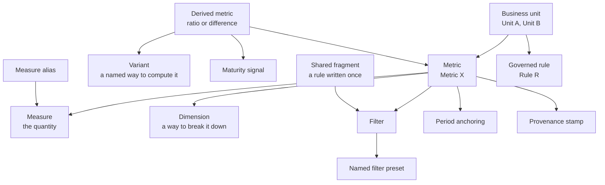
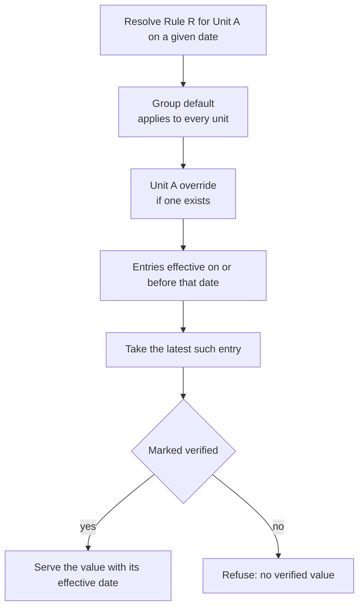

# Knowledge model

The knowledge layer is what makes an answer canonical. It holds the meaning of every metric as version-controlled data, so a definition can be validated, reviewed, diffed and stamped into the answers it produced.

This document describes the concepts. It contains no definitions, because a real definition encodes the business it was written for.

---

## How the concepts relate

The concepts in the definition model and which ones compose into which.

## The concepts

**Business unit.** The scope that owns a set of metrics. Units are the unit of access control, the unit of database role, and the unit of override for governed rules. Everything else hangs off a unit.

**Metric.** A named quantity with exactly one meaning. The name is the contract: if two calculations are both legitimate, they are two metrics with two names, never one name whose meaning depends on who asked. This is the single most important rule in the model.

**Measure.** The quantity being aggregated. A metric names its measure rather than embedding an expression, so the same quantity can be referenced from several metrics without being rewritten.

**Dimension.** A way to break a metric down. Dimensions are declared per metric, which means a breakdown a definition does not declare is not available, rather than being silently approximated.

**Filter and named filter preset.** A filter narrows what the metric counts. Where a particular narrowing is requested often, it is named once as a preset so callers ask for the preset rather than reconstructing the filter. A preset is a contract in the same way a metric name is.

**Period anchoring.** How a requested period maps onto the data: which date field anchors the metric, and how boundaries are treated. Windows are half-open, so a record on a boundary belongs to exactly one period. Without this, two adjacent periods both count it and the year does not equal the sum of its months.

**Derived metric.** A ratio or difference of other metrics. Each leg is a metric in its own right, so a derived value cannot disagree with its own components.

**Variant and per-leg options.** One derived metric often has several defensible forms, differing in how a leg is restricted. Each form is a named variant rather than a default somebody chose. A caller asking for the metric without naming a variant gets the declared default, and the answer says which variant it was.

**Maturity signal.** Some values keep moving after their window closes, because records arrive late. The model marks these, and an answer for such a window says the value is still maturing. Presenting a moving number as final is how a figure in a document comes to contradict the same figure a fortnight later.

**Shared fragment.** A business rule expressed once, given a name, and referenced wherever it applies. The alternative is copying the rule into every definition that needs it, and copies drift: two definitions that embedded the same rule separately disagreed within months, and neither owner knew. See [ADR 0008](decisions/0008-shared-fragments.md).

**Measure alias.** Different units sometimes name the same quantity differently for historical reasons. An alias maps those names onto one measure so the units can be combined in a composite answer without renaming anything upstream.

**Governed rule.** A business rule with a value that changes over time, served as data rather than remembered. Rules are layered and effective-dated; see below.

**Provenance stamp.** The version of the knowledge that produced an answer. It travels with the value, so a number found later in a document can be traced to the definition as it stood when the number was produced.

**Glossary, schema notes and reference data.** Supporting knowledge: what a term means, what is known about the shape of a source, and curated lists that callers need in order to ask a sensible question.

## How a governed rule resolves

A rule has a group-wide default, optional per-unit overrides, and a history. Resolution walks from the most general to the most specific, then takes the newest entry that was already in force on the date asked about.

Rule resolution: general to specific, then the latest entry already in force, and only if somebody has verified it.

Three properties follow from this shape:

- **Asking about the past gives the past's answer.** A question about an earlier period resolves the rule as it stood then, not as it stands now.
- **An unverified value is not served.** A draft entry is refused rather than returned, because a plausible wrong rule is more damaging than a visible gap. See [ADR 0009](decisions/0009-verified-effective-dated-rules.md).
- **The effective date travels with the value.** The caller learns not only what the rule is but since when, which is usually the next question.

## What this model deliberately does not do

It does not let a caller supply a calculation. A caller selects from declared metrics, dimensions, presets and variants; anything else is a change to the knowledge layer, which is a reviewed change with an author and a history.

That restriction is the whole point. A system that accepts arbitrary calculations can produce any number, and a number that could have been anything cannot be canonical.
