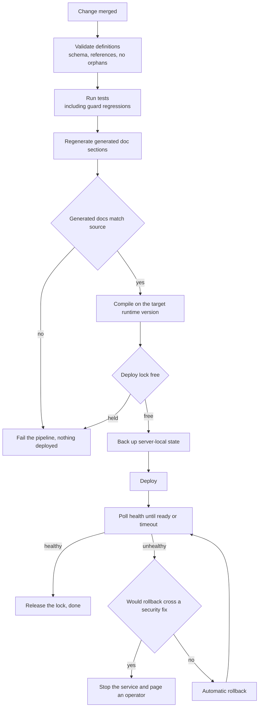

# Operations

The server is small and self-hosted. The operational goals are that a deploy is boring, a bad deploy is reversible without thinking, and a failure is distinguishable from a refusal.

---

## The delivery pipeline

The deploy path, with the two places it refuses to continue: stale generated docs, and a rollback that would reinstate a known vulnerability.

Several of these steps exist because of a specific incident.

**Compile on the target runtime version.** A deploy once crash-looped because the artefact was built against a different runtime than the one the server runs. The build now happens on the target version, so a mismatch fails the pipeline instead of the service.

**Take the deploy lock.** Two concurrent deploys interleaved their state writes once. A lock makes the second wait or fail rather than corrupt.

**Back up server-local state first.** State that lives on the server, such as the live grant overlay, is captured before every deploy. Recovery is then a restore rather than a reconstruction from memory.

## Rollback rules

Automatic rollback runs when health checks fail after a deploy. Two rules bound it.

**Rollback stops the service rather than crossing a security fix.** If the previous version is one with a known vulnerability, rolling back would trade an outage for a silent exposure. An outage is loud, bounded and gets fixed; an exposure is none of those. The pipeline stops the service and pages an operator instead. See [ADR 0013](decisions/0013-security-aware-rollback.md).

**Rollback restores state alongside code.** Reverting code while leaving migrated state behind produces a system that is neither version, which is harder to reason about than either.

## Health checks

Two checks, answering different questions.

| Check | What it proves | Used by |
|---|---|---|
| Liveness | The process is up and serving | Process supervision, deploy gating |
| Deep check | The process can reach the warehouse and load the knowledge layer | Deploy gating, monitoring |

A liveness check alone would let a server that cannot reach the warehouse pass a deploy and then refuse every request. The deep check is what the pipeline waits on.

## Logging

The usage log is append-only, rotated monthly, with owner-only file permissions. It records the decision for every request: caller, tool, unit, knowledge version, outcome, and the reason for a refusal. It does not record query text and does not record personal data.

Error kinds separate rejected requests from real failures. This distinction carries the operational load: a rise in refusals means a grant is missing or something is probing, while a rise in failures means something is broken. Collapsing both into one error count hides both signals.

## Incident playbook

**Numbers look wrong.** Take the provenance stamp from the answer in question and read the definition at that version. A definition change, a shared fragment change or an upstream label change will be visible in its history. Reproduce the metric at the old and new versions before changing anything.

**A metric returns zero.** Treat zero as suspect until proven. Check freshness of the upstream source first: an empty result from a stale feed formats identically to a true zero. The freshness guard should have refused the answer, so a zero that reached a caller is also a gap in the guard.

**Refusals have risen.** Read the refusal reasons in the log. A cluster from one caller is usually a missing grant. A cluster from one tool across callers is usually a definition or validator problem. A cluster of unclassifiable statements from the ad-hoc guard means either somebody is probing or the parser has met a legitimate shape it does not know.

**Latency has risen.** Check whether a filter shape has disabled parallel execution before looking at the warehouse. One such change made a derived metric serialise its legs, which presented as the warehouse being slow.

**A deploy will not come up.** The pipeline has already rolled back, or stopped the service because rolling back would cross a security fix. The log says which. If it stopped, the fix goes forward: deploy a corrected version rather than reaching for the previous one.

**Access was granted and is not working.** Check the overlay first, then reconciliation. A grant present in version control but not in the overlay takes effect at the next deploy; a grant in the overlay but never reconciled will disappear at the next one.
