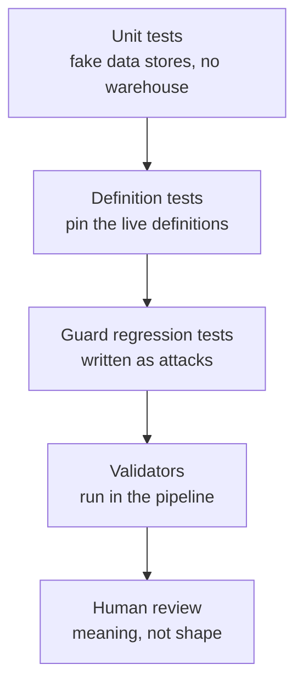

# Quality

Two different things need to be true, and they need different kinds of test. The code must do what it is supposed to do. The definitions must mean what the business thinks they mean. A test suite that only checks the first will pass while every number is wrong.

---

## The layers

Four automated layers and one human one, in the order they catch things.

**Unit tests run against fake data stores.** The compiler, the executor, the policy enforcer and the guard are tested without a warehouse. This keeps the suite fast enough to run on every change, and it means a failing test points at logic rather than at an environment.

**Definition tests pin the live definitions.** These load the real knowledge layer and assert properties that must hold: every reference resolves, every metric declares its anchoring, every derived metric's legs exist, no metric name is reused with a different meaning. They fail when somebody edits a definition in a way that is syntactically fine and semantically broken.

**Guard regression tests are written as attacks.** Each one encodes a specific bypass and asserts the refusal. They are written to fail first against the unfixed code, which is the only way to know the test exercises the hole rather than passing for an unrelated reason. This is not a theoretical concern: two tests in this suite originally passed against vulnerable code, because the statement they used was refused for a different reason than the one under test. A test that passes for the wrong reason is worse than no test, because it buys confidence it has not earned.

**Validators run before tests in the pipeline.** They check the shape of the knowledge layer: schema conformance, resolvable references, no orphaned fragments, no rule without an effective date, no unverified rule marked servable.

**Review is the last layer and the weakest.** A definition can satisfy every validator and every test and still be wrong about the business. Nothing automated catches that. What helps is that definitions are small, declarative and diffable, so a reviewer reads a change rather than inferring it from code.

## Generated documentation is tested

The sections of the documentation that list metrics, tools and modules are generated from the source. A test fails when they are out of date.

This exists because documentation that drifts is worse than documentation that is absent: a reader trusts it, and the trust is misplaced. Making staleness a test failure moves the problem from somebody's good intentions to the pipeline. See [ADR 0012](decisions/0012-docs-generated-from-source.md).

## What is deliberately not tested

**The warehouse's own behaviour.** The suite assumes the warehouse is correct about its own semantics. Where the system must agree with it, as the guard's lexer must, that agreement is pinned by a regression test rather than reimplemented and hoped for.

**Numbers against other reports.** Comparing a metric with an existing report tests two things at once and cannot say which is wrong. Metrics are tested for internal consistency, including that a total equals the sum of its parts and that adjacent periods do not double-count a boundary record.

## Review practice

Changes to the knowledge layer are reviewed for meaning, with the definition's owner named. Changes to the guard require a regression test that fails before the change. Changes to the policy are reviewed for whether the grant is the narrowest one that solves the problem, since a broad grant is quicker to write and permanent in practice.
