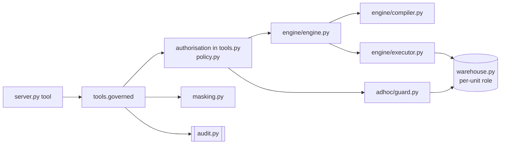

# Reference implementation

This repository includes a reference implementation of the architecture described in these documents: a Python MCP server, a synthetic example knowledge layer, and a local warehouse to run it against. Nothing in it is taken from a production deployment. The example business is invented, and every identity is a placeholder on `example.com`.

The prose documents describe *why*. This one maps the design onto the code and lists what the code contains. The inventory sections below are generated from the source by `scripts/gen_docs.py`, and the test suite fails when they are stale ([ADR 0012](decisions/0012-docs-generated-from-source.md)).

---

## Where each component lives

| Component ([architecture.md](architecture.md)) | Module |
|---|---|
| Tool surface | `server.py` registers tools, `tools.py` holds their bodies and the `governed` wrapper |
| Policy enforcer | `policy.py` (deny by default), consulted in `tools.py` before the engine runs |
| Live grant overlay | `overlay.py`, merged by `policy.load_policy`, written by `admin.py` |
| Knowledge loader | `knowledge/loader.py` parses, `knowledge/validate.py` cross-checks, `knowledge/model.py` holds the frozen result |
| Query compiler | `engine/compiler.py` |
| Executor | `engine/executor.py` (parallel legs, first failure stops, one retry per statement) |
| Result cache | `engine/cache.py`, keyed on the knowledge version by `engine/engine.py` |
| Ad-hoc guard | `adhoc/lexer.py`, `adhoc/references.py`, `adhoc/personal.py`, `adhoc/guard.py` |
| Masking chokepoint | `masking.py`, applied to every result by `tools.governed` |
| Audit writer | `audit.py` |
| Identity | `identity.py` (JWT bearer verification on HTTP, a configured local identity on stdio) |
| Admin console | `admin.py` (behind the proxy's single sign-on) |
| Deep check | `server.deep_check`, served on `/readyz` |
| Delivery pipeline | `scripts/deploy.sh` |

## Request path in code



Every tool body runs inside `tools.governed`, which takes one knowledge snapshot and one policy for the call, maps every exception to one of the four error kinds, applies the masking chokepoint to the result, and writes exactly one audit line.

## Where identity is verified

[architecture.md](architecture.md) places single sign-on at the proxy. This implementation splits it by client. Browsers reach the admin console through the proxy's single sign-on, and the proxy forwards the verified identity together with a shared secret. MCP clients authenticate with bearer tokens rather than browser sessions, so on the MCP endpoint the server acts as an OAuth resource server and verifies the identity provider's token itself (`identity.py`). The property the documents rely on holds either way: the server acts only on an identity it verified, never on one carried in request text.

## Departures from the documents

- **Rollback does not restore state.** The only server-local state is the overlay and the audit log, both append-only and never migrated, so restoring the pre-deploy backup would erase grants and decisions recorded since. The backup is kept as the operator's restore point; `scripts/deploy.sh` says where to add a restore if a release ever migrates state.
- **A stale source is reported with the `failure` kind and the reason `stale_source`.** The four-kind vocabulary stays intact, and the reason keeps staleness distinguishable from a broken component.

## The definition format

A metric is one YAML file under `knowledge/metrics/`, named after its key. See `examples/knowledge/` for a complete, validated example.

```yaml
key: revenue                      # must equal the file name; the name is the contract
description: Value of paid countable orders placed in the period.
owner: commerce-analytics
version: 3                        # stamped into every answer as provenance
effective: 2026-02-01
units:
  unit_a:
    source: unit_a.orders         # must be a source declared for this unit in units.yaml
    alias: o
    joins:                        # optional; joined sources must also belong to the unit
      - {source: unit_a.refunds, alias: r, condition: "r.order_id = o.order_id", kind: left}
    period_column: o.ordered_at   # or `snapshot: true` for a point-in-time value
    base_filter: "{{ countable_order(o) }} AND o.status = 'paid'"
    measures:
      gross: {sql: "SUM(o.gross_amount)", additive: true}    # additivity is declared, never inferred
    default_measure: gross
    measure_aliases: {}           # another unit's name for the same quantity
    dimensions:
      channel: {sql: o.channel}
      customer_email: {sql: o.customer_email, personal: true}   # masked on the way out
    presets:
      first_orders: {sql: o.is_first_order, description: Each customer's first order.}
    maturity:                     # required when a source declares late_arriving_days
      settles_after_days: 30
      note: Why the value keeps moving.
```

A derived metric sets `kind: derived` and gives each unit an `op` (`ratio` or `difference`), named `variants` of numerator and denominator legs, and a `default_variant`. Each leg names a structured metric, and optionally a measure and a pinned preset.

Units and their sources live in `units.yaml`, where a source can declare `freshness`, `personal_columns` and `late_arriving_days`. Shared fragments live in `fragments.yaml` and are referenced as `{{ name(alias) }}`. Governed rules live in `rules/<domain>.yaml` as dated entries, each marked `verified: true` or `false`.

## Tools

<!-- gen:tools -->
| Tool | Kind | Purpose |
|---|---|---|
| `list_metrics` | read-only | List the canonical metrics you can read, with their measures, dimensions, presets, variants and anchoring. Optionally narrow to one unit. Call this first. |
| `get_metric` | read-only | The canonical value of one metric in one unit. start inclusive, end exclusive (YYYY-MM-DD); omit both for all-time. `measure` picks a quantity of a structured metric, `variant` a form of a derived one. `filters` binds dimension = value. verbose=true adds the compiled statement for audit. |
| `get_metric_breakdown` | read-only | A metric grouped by one declared dimension. order: value_desc (default), value_asc or dimension; limit for top-N. truncated=true means more groups exist. |
| `get_composite_metric` | read-only | One metric across every unit you can read: each unit's value, its share, and the total when the measure is additive. units_covered says what the total covers. |
| `compare_periods` | read-only | A metric over two periods with the absolute and relative change. |
| `list_rules` | read-only | The governed-rule catalogue (domains, keys, overrides). Values come from resolve_rule. |
| `resolve_rule` | read-only | The verified value of a governed rule for a unit as of a date (default today), with the layer that won and its effective date. An unverified rule is refused. |
| `get_glossary` | read-only | What a term means, as the organisation defines it. Omit term for the full glossary. |
| `list_sources` | read-only | The sources your ad-hoc access covers in a unit (requires an ad-hoc grant). |
| `describe_source` | read-only | Columns and types of one ad-hoc source, with personal columns flagged. |
| `run_query` | read-only, open world | Guarded, NON-CANONICAL ad-hoc SELECT for exploration where no metric exists. One read-only statement over schema-qualified sources in your grant; row-capped and timed out. Aggregate rather than paging through rows. Prefer get_metric whenever possible. |
| `reload_knowledge` | administrative | Administrators only: re-read definitions and policy. Invalid knowledge is rejected and the current version keeps serving. |
<!-- /gen:tools -->

## Error vocabulary

<!-- gen:errors -->
| Kind | Caller's next step |
|---|---|
| `invalid_request` | Fix the request: it was malformed, or the guard could not classify it. |
| `access_denied` | Request a grant: the caller is not entitled to what was asked. |
| `timeout` | Narrow the period or the breakdown: the statement exceeded its limit after one retry. |
| `failure` | Nothing: something inside the system broke, or a source is stale. Operators are alerted. |
<!-- /gen:errors -->

## Modules

<!-- gen:modules -->
| Module | Lines | Responsibility |
|---|---|---|
| `governed_metrics/__init__.py` | 3 | Governed Metrics MCP: one canonical, governed answer for every business metric. |
| `governed_metrics/__main__.py` | 56 | Entry point: `governed-metrics` or `python -m governed_metrics`. |
| `governed_metrics/admin.py` | 262 | The admin console: grant and revoke access now, see what is pending reconciliation. |
| `governed_metrics/audit.py` | 98 | The audit log: one append-only line per decision, refusals included. |
| `governed_metrics/config.py` | 172 | Runtime settings, read once from the environment into an immutable object. |
| `governed_metrics/errors.py` | 83 | One error vocabulary for every tool: invalid request, access denied, timeout, failure. |
| `governed_metrics/identity.py` | 88 | Who is asking: the verified identity every authorisation decision starts from. |
| `governed_metrics/masking.py` | 77 | The masking chokepoint: the one place personal data is masked on the way out (ADR 0007). |
| `governed_metrics/overlay.py` | 117 | The live grant overlay: access granted now, reconciled into version control later (ADR 0014). |
| `governed_metrics/policy.py` | 256 | The access policy: deny by default, resolved from the verified identity (docs/access-model.md). |
| `governed_metrics/rules.py` | 78 | Governed rules: layered, effective-dated, served only when verified (ADR 0009). |
| `governed_metrics/runtime.py` | 129 | The runtime: the knowledge snapshot, the policy, the engine and the audit log, together. |
| `governed_metrics/server.py` | 213 | MCP wiring: the tool surface, health checks and the admin console on one server. |
| `governed_metrics/tools.py` | 404 | Tool bodies, independent of the MCP transport (server.py only wires them up). |
| `governed_metrics/warehouse.py` | 142 | Warehouse access, one read-only credential per unit (ADR 0006). |
| `governed_metrics/adhoc/__init__.py` | 1 | The guarded ad-hoc path: lexer, reference parser, personal-data guard. |
| `governed_metrics/adhoc/guard.py` | 78 | The ad-hoc guard: decide whether a caller-supplied statement may run, before it runs. |
| `governed_metrics/adhoc/lexer.py` | 205 | A single-pass SQL lexer that reads a statement the way PostgreSQL does (ADR 0004). |
| `governed_metrics/adhoc/personal.py` | 207 | Guards against rebuilding a masked personal field inside an ad-hoc query (ADR 0007). |
| `governed_metrics/adhoc/references.py` | 556 | Structural analysis of an ad-hoc statement, over tokens (ADR 0004, ADR 0005). |
| `governed_metrics/engine/__init__.py` | 1 | The metric engine: compile definitions, run legs, attach freshness, maturity and provenance. |
| `governed_metrics/engine/cache.py` | 60 | A small thread-safe TTL + LRU cache for canonical results. |
| `governed_metrics/engine/compiler.py` | 174 | Compile a definition into one parameterised, read-only statement. |
| `governed_metrics/engine/engine.py` | 323 | The metric engine: compile, execute, and stamp canonical answers. |
| `governed_metrics/engine/executor.py` | 52 | Run independent legs concurrently; retry one timed-out statement once (ADR 0011). |
| `governed_metrics/engine/freshness.py` | 83 | Freshness: a stale source is refused, never rendered as a number (ADR 0010). |
| `governed_metrics/knowledge/__init__.py` | 1 | The knowledge layer: definitions, rules, fragments and glossary as validated, immutable data. |
| `governed_metrics/knowledge/fragments.py` | 54 | Shared fragments: a business rule written once, referenced everywhere (ADR 0008). |
| `governed_metrics/knowledge/loader.py` | 495 | Load the knowledge directory into one validated, immutable `Knowledge` snapshot. |
| `governed_metrics/knowledge/model.py` | 212 | The definition model as immutable values (docs/knowledge-model.md). |
| `governed_metrics/knowledge/validate.py` | 136 | Cross-reference checks over a parsed knowledge snapshot (docs/quality.md, "Validators"). |
<!-- /gen:modules -->

## Example metrics

<!-- gen:metrics -->
| Metric | Unit | Kind | Version | Shape (default in bold) | Matures |
|---|---|---|---|---|---|
| `active_products` | unit_a | structured | v1 | measures: **count** · snapshot | — |
| `orders` | unit_a | structured | v2 | measures: **count**, customers · period | — |
| `orders` | unit_b | structured | v2 | measures: **count**, customers · period | — |
| `refund_rate` | unit_a | derived | v1 | ratio · variants: by_count, **by_value** | 30 days |
| `refund_rate` | unit_b | derived | v1 | ratio · variants: by_count, **by_value** | 30 days |
| `refunds` | unit_a | structured | v1 | measures: **amount**, count · period | 30 days |
| `refunds` | unit_b | structured | v1 | measures: **amount**, count · period | 30 days |
| `revenue` | unit_a | structured | v3 | measures: average_order_value, gross, **net** · period | — |
| `revenue` | unit_b | structured | v3 | measures: average_order_value, gross, **net_sales** · period | — |
<!-- /gen:metrics -->
