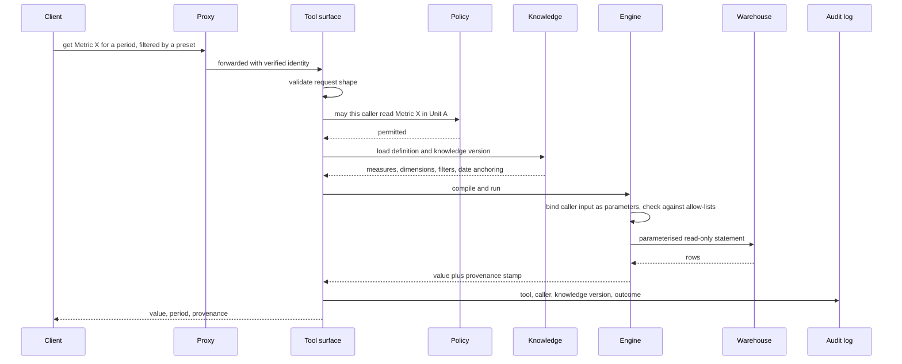
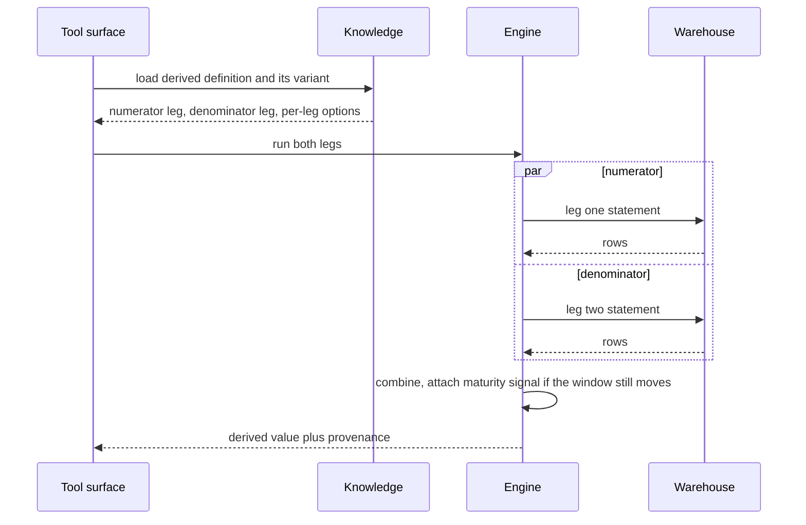
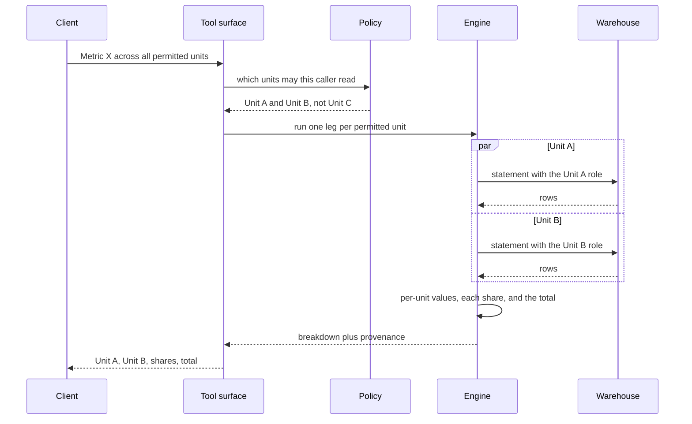
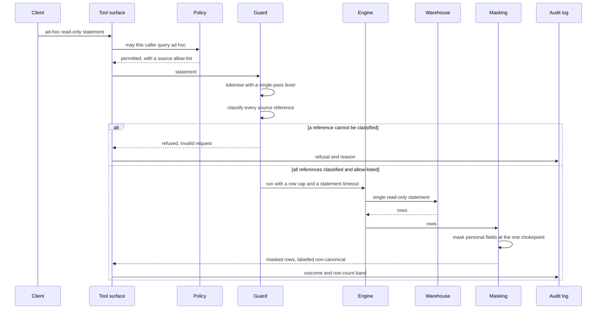
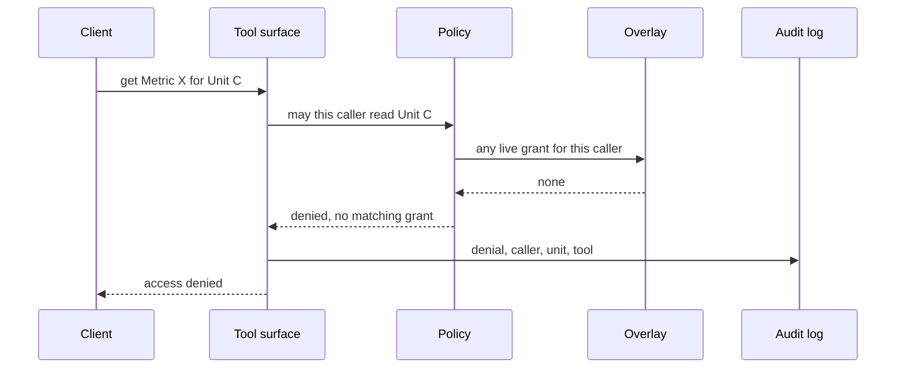

# Request lifecycle

Five representative requests, from the client call to the answer. Participants are the components described in [architecture.md](architecture.md).

Two properties hold in every one of them: the policy is consulted before the engine does any work, and the outcome is logged whether it succeeded or was refused.

---

## A canonical metric call

The ordinary path: policy first, then definition, then a parameterised query, then a stamped answer.

The date window is half-open, so a period boundary belongs to exactly one period and adjacent periods never double-count the same record.

## A derived metric with parallel legs

A derived metric is a ratio or difference of other metrics. Each leg is an independent query, so the legs run concurrently.

Independent legs run concurrently; the engine combines them and marks the result when its window is still moving.

Two details matter here. The engine stops at the first failing leg rather than waiting for the rest, so a failure costs one leg's time instead of all of them. And where a value keeps changing after its window closes, because records arrive late, the answer carries a maturity signal rather than presenting a moving number as final.

## A cross-unit composite call

A composite returns each permitted unit, its share and the total; a unit the caller cannot read is absent, not zero.

The policy decides the set of legs before any query runs. A unit the caller is not entitled to see never appears, and the total is the total of what was returned. Presenting a partial total as a complete one would be worse than refusing, so the response states which units it covers.

## A guarded ad-hoc query

The ad-hoc path refuses before it executes, caps what it returns, and labels the answer non-canonical in the response itself.

The guard tokenises the statement the way the warehouse does rather than matching patterns against the text. The reason is in [ADR 0004](decisions/0004-lexer-not-regular-expressions.md): chained regular expressions were bypassable, because a comment or a nested sub-select changes the spelling of a statement without changing what it does.

Even when the guard passes a statement, the credential used to run it is the caller's unit role. The guard narrows what is attempted; the role bounds what is possible.

## An access denial

A denial is a first-class outcome: it is specific to the caller, recorded, and returned as its own error kind.

The response says access was denied without saying what exists behind the boundary. The log records the denial, because a pattern of refusals is the signal that either a grant is missing or something is probing. A guard that refuses silently teaches nobody anything.

## One error vocabulary

Every outcome maps to one of four kinds, across every tool.

| Kind | Meaning | Caller's next step |
|---|---|---|
| Invalid request | The request or statement was malformed, or the guard could not classify it | Fix the request |
| Access denied | The caller is not entitled to what was asked | Request a grant |
| Timeout | The statement exceeded its limit, after one retry | Narrow the period or the breakdown |
| Failure | Something inside the system broke | Nothing; this is the operators' problem |

Separating a refusal from a failure matters more than it looks. A refused request is the system working. If both arrive as a generic error, the usage log cannot distinguish a caller who needs access from a component that is broken, and neither gets attention.
