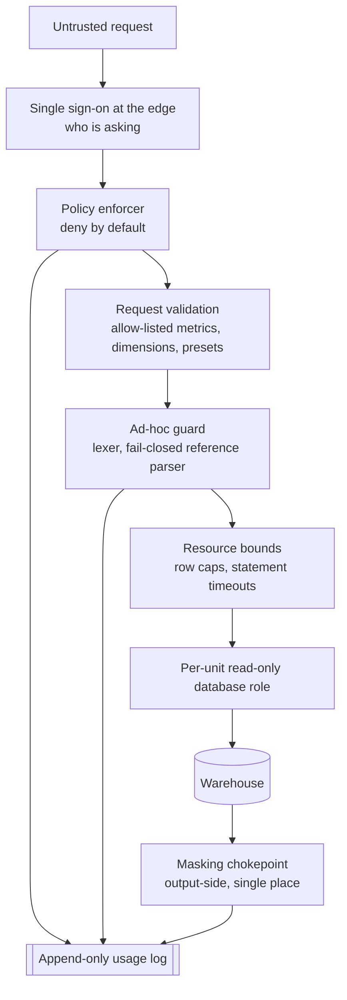

# Security

The system exposes a read path into a warehouse to AI clients. Two assumptions shape every control in it.

First, request text is untrusted even when the caller is trusted. An assistant composes requests from whatever it has read, which may include a document, a ticket or a web page authored by somebody else. A verified identity tells you who is at the keyboard, not what steered the request.

Second, application guards are software and software has defects. Two were found in this one, both written up in [lessons-learned.md](lessons-learned.md). The controls are therefore layered so that no single guard is the only thing preventing a cross-unit read.

---

## Where the controls sit

Each control narrows what a request can do; the database role is the one that holds even if the others fail.

The ordering is deliberate. Identity is established before authorisation, authorisation before any query is built, and the credential is chosen by unit rather than shared. The masking chokepoint sits on the way out because masking applied in several places is masking that will eventually be forgotten in one of them.

## Threat model

| Threat | STRIDE | Control | Where it lives |
|---|---|---|---|
| Caller impersonates another person to reach their data | Spoofing | Single sign-on at the edge; the server trusts only the verified identity, never a caller-supplied one | Edge, policy enforcer |
| Request text steers the assistant into asking for data the person may not see | Spoofing, Elevation | Authorisation is resolved from the verified identity and the policy, never from request content; deny by default | Policy enforcer |
| Caller input is spliced into query text to change the query | Tampering | Input is bound as parameters and checked against allow-lists; it never reaches query text | Query compiler |
| Ad-hoc statement hides a write or a second statement | Tampering | A single read-only statement only; single-pass lexer; fail-closed reference parser; read-only role | Guard, database role |
| Statement reads a source belonging to another unit | Information disclosure | Positive per-unit allow-list of readable sources, per-user source allow-lists, and a database role that cannot see the others | Guard, policy, database role |
| Personal data returned to a caller not entitled to it | Information disclosure | Output-side masking at one chokepoint, plus guards against reconstructing masked fields inside the query | Masking chokepoint |
| An answer is quoted later and cannot be traced | Repudiation | Provenance stamp on every answer; append-only usage log of every decision | Engine, audit writer |
| Unbounded scan degrades the warehouse for everyone | Denial of service | Row caps, statement timeouts, one retry only, result cache keyed on knowledge version | Executor |
| Expensive breakdown is silently cut short and reads as complete | Information disclosure | Truncation is flagged in the response rather than applied quietly | Executor |
| Stale upstream feed returns empty and is read as zero | Information disclosure | Freshness checks; a stale answer is refused rather than rendered | Engine |
| Administrator grants access and nobody can later explain why | Repudiation | Live grants are reconciled back into version control with an author and a date | Overlay, delivery pipeline |
| Admin surface is driven by a third-party page or script | Tampering, Elevation | Admin rights separate from data access, cross-site request forgery protection, strict content security policy | Admin console |
| Rollback silently reinstates a known vulnerability | Elevation | Rollback refuses to go back past a security fix and stops the service instead | Delivery pipeline |
| Usage log itself leaks what it was meant to protect | Information disclosure | The log records decisions, not query text and not personal data; owner-only file permissions; monthly rotation | Audit writer |

## The control that actually matters

Everything in the table above is a wall in front of the credential. The credential is the control.

A read-only role scoped to one unit's sources cannot read another unit's data regardless of what statement reaches it. No defect in the lexer, the reference parser, the policy enforcer or the tool surface can turn that credential into a cross-unit read. The guards exist to refuse early, to give the caller a useful error, and to keep the warehouse healthy. They are not the boundary.

This is worth stating plainly because the opposite arrangement is common and looks similar from the outside: one broad credential, with the application deciding what may be read. That design is one bug away from reading everything, and the bug is usually in the guard nobody suspected. See [ADR 0006](decisions/0006-least-privilege-roles.md).

## Residual risks

**A permitted caller can still read permitted data for an impermissible reason.** Authorisation answers whether someone may see a number, not whether they should be looking. The usage log makes the pattern visible after the fact; nothing prevents it at the time. Closing this needs review of access patterns rather than another guard.

**Masking reduces precision, it does not eliminate inference.** A caller who can group and count can sometimes narrow a masked value down, particularly in a small group. Minimum group sizes for breakdowns on sensitive dimensions are on the roadmap.

**The lexer must track the warehouse.** The guard tokenises the way the warehouse does, so a warehouse upgrade that changes lexical rules can move them apart. Regression tests pin the agreement, and the upgrade checklist includes rerunning them, but the risk is structural rather than solved.

**Definitions are reviewed by people.** A definition can be valid, pass every test and still be wrong about the business. Validators catch shape, not meaning. Review practice is the control, and it is the weakest one in the system.

**Client-side history is outside the boundary.** Answers delivered to an assistant live in that assistant's conversation, under whatever retention the client applies. The system governs what leaves it, not what happens afterwards.
